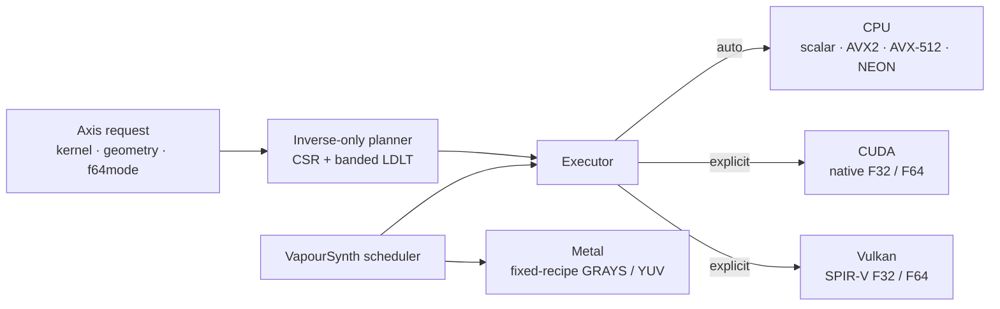

# dsmvc

[](https://github.com/MysteryDove/vapoursynth-descalemvc/actions/workflows/build.yml)
[](LICENSE)


`dsmvc` is a VapourSynth API4 plugin compatible with the public filter API of
Irrational-Encoding-Wizardry/descale, with native Metal, Vulkan, CUDA, and CPU
(scalar, AVX2/FMA, AVX-512, NEON).

For native-resolution discovery, use [GetNative-VF](https://github.com/MysteryDove/GetNative-VF),
a faster `getnative` alternative built on `dsmvc`. Its own candidate scan
reaches about **3,600 candidates/s** with CUDA on an RTX 5080, roughly **65x**
the same scan on the original descale plugin. That figure belongs to
GetNative-VF; the numbers for `dsmvc` itself are in the
[performance snapshot](#performance-snapshot).

## Hardware support at a glance

| Route | Supported hardware |
|---|---|
| CPU | x86-64 with a universal scalar path and optional AVX2/FMA or AVX-512F/DQ/BW/VL acceleration; ARM64/AArch64 with scalar and NEON/FMA paths. Automatic routing selects the fastest path supported by the current CPU. |
| CUDA | NVIDIA Turing or newer (compute capability 7.5+) on Windows and Linux. Covering GeForce GTX 16/RTX 20, RTX 30, RTX 40, and RTX 50 series respectively. |
| Vulkan | Windows or Linux devices with a Vulkan 1.2 driver. Float64 additionally requires the capabilities listed in [Backend support](#backend-support). |
| Metal | Apple Silicon M-series systems on macOS 13.3 or newer. Retained-Float64 work uses the CPU fallback. |

CUDA devices without a matching native image (Like a Datacenter Nvidia GPU) can use the embedded compute_75
or compute_120 PTX through NVIDIA driver JIT when compatible.

> **Release performance and output error:**
> Measured CPU/ARM/Vulkan results are listed in the [full release
> benchmark](docs/release-benchmark.md) and [ARM benchmark](docs/arm-benchmark.md).

## Usage

The native VapourSynth plugin accepts constant-format GRAY, YUV, and RGB
clips. Integer and non-Float32 input is converted internally when needed. For
subsampled formats, the output dimensions must remain compatible with the
source chroma subsampling.

```python
core.std.LoadPlugin(path=r"C:\path\to\dsmvc.dll")
output = core.dsmvc.Debicubic(source, 1280, 720, b=0.0, c=0.5)
# GPU backends are opt-in:
gpu_output = core.dsmvc.Debicubic(source, 1280, 720, b=0.0, c=0.5, backend="cuda")
vulkan_output = core.dsmvc.Debicubic(source, 1280, 720, b=0.0, c=0.5, backend="vulkan")
```

Every function takes `clip src, int width, int height`, its kernel arguments,
and the shared arguments below:

| Function | Kernel arguments |
|---|---|
| `Debilinear` | — |
| `Debicubic` | `b=0.0`, `c=0.5` |
| `Delanczos` | `taps=3` |
| `Despline16` / `Despline36` / `Despline64` | — |
| `Descale` | `kernel`, `taps`, `b`, `c`, or a custom kernel via `custom`/`support` or `custom_kernel`/`taps` |

| Shared argument | Default | Meaning |
|---|---|---|
| `blur` | `1.0` | Stretches the kernel (JET v12 compatible). |
| `src_left`, `src_top`, `src_width`, `src_height` | `0`, `0`, `width`, `height` | Source sampling window. |
| `force`, `force_h`, `force_v` | `0` | Same as the original descale. |
| `padding` | `3` | Edge extension: `0` zero, `1` repeat, `2` reflect101, `3` symmetric. Cannot be combined with the legacy `border_handling`. |
| `backend` | `"auto"` | `auto`, `cpu`, `cuda`, `vulkan`, or `metal`. `auto` uses CPU (or the Metal scheduler on Apple builds). An explicit CUDA or Vulkan request raises an error instead of falling back. |
| `f64mode` | `0` | `0` uses Float64 automatically for ill-conditioned solves, `1` forces Float32, `2` forces Float64. |
| `opt` | `0` | CPU path: `0` auto, `1` scalar, `2` AVX2 or NEON, `3` AVX-512. |

The plugin is API4 only and registers `core.dsmvc`, not `core.descale`.
[dsmvc.py](dsmvc.py) is a Python wrapper that keeps the original descale
wrapper's format handling. Full signatures and per-argument details are in the
[reference](docs/reference.md).

## Backend support

| Backend | Float32 | Float64 | Integer output | Routing |
|---|---|---|---|---|
| CPU scalar | ✅ | ✅ | reference | `auto` / explicit |
| CPU AVX2 (x86-64) | ✅ | ✅ | <= 1 code vs scalar | `auto` / explicit |
| CPU AVX-512 (x86-64) | ✅ | AVX2 kernels | <= 1 code vs scalar | `auto` / explicit |
| CPU NEON (AArch64) | ✅ | ✅ | <= 1 code vs scalar | `auto` / explicit |
| CUDA | ✅ | ✅ | <= 1 code vs scalar | explicit only |
| Vulkan 1.2 | ✅ | ✅¹ | <= 1 code vs scalar | explicit only |
| Metal (Apple ARM64) | ✅ | routed to CPU² | <= 1 code vs scalar | mixed plugin-level |

¹ Needs `shaderFloat64` and strict rounding support on the device; otherwise
the request is rejected with an error.

² Metal builds run Float64 plans on the CPU.

Every backend stays within 1 code (integer output) or 1 ULP (Float64 output)
of the CPU scalar reference. The full
[numerical contract](docs/reference.md#numerical-contract) is in the reference.



## Performance snapshot

The following snapshot combines the latest RTX 5080 CUDA candidate scan with
the published CPU, ARM, and Vulkan release reports. Candidate/s figures are
end-to-end GetNative graph measurements unless noted otherwise; GPU backends
are explicitly selected.

| Platform / route | Candidate-scan result | Comparison |
|---|---|---|
| RTX 5080 / CUDA | **417.457 candidates/s** | **7.30x** original descale |
| Ryzen 9 5950X / CPU at R32T32 | **370.049 candidates/s** | **6.47x** original descale |
| Apple M4 Max / ARM NEON at R16T16 | **421.237 candidates/s** | **2.25x** original descale |
| RTX 5080 / Vulkan at R32T32 | **353.068 candidates/s** | **2.618x** the v0.1.0 Vulkan result; refreshed 2026-08-27 |

The CUDA/CPU/ARM/Vulkan measurements use different hosts and request levels;
compare ratios within each benchmark rather than absolute candidates/s across
machines. See the [CPU/CUDA/Vulkan report](docs/release-benchmark.md) and
[ARM report](docs/arm-benchmark.md) for fixed-kernel, BlankClip, accuracy, and
backend-contract results.

All GPU timings were serialized under a benchmark lock during the private
benchmark runs.

## Build

Requirements:

- CMake 3.24 or newer
- A C++23 compiler
- VapourSynth API4 headers
- On Windows, Visual Studio 2022 with the x64 C++ workload

```sh
cmake -S . -B build -DDSMVC_VAPOURSYNTH_SDK=/path/to/vapoursynth
cmake --build build --config Release --parallel
```

Add `-DDSMVC_ENABLE_CUDA=ON` (CUDA Toolkit) or `-DDSMVC_ENABLE_VULKAN=ON`
(Vulkan SDK with `glslc`) for the GPU backends on Windows and Linux. Metal is
enabled by default on native Apple ARM64 builds; pass `-DDSMVC_ENABLE_METAL=OFF`
for CPU only.

Per-backend build notes and the `DSMVC_CUDA_*` / `DSMVC_VULKAN_*` runtime
environment variables are in [docs/building.md](docs/building.md).

## Benchmark

The benchmark runners, case definitions, and the Apple ARM64 validation
workflow are documented in [benchmarks/README.md](benchmarks/README.md).

## More documentation

- [Reference](docs/reference.md): full signatures, argument details, numerical contract, CPU paths
- [Building and tuning](docs/building.md): backend builds and environment variables
- [Frame I/O](docs/frame-io.md): classic direct transfers and GPU frames
- [GPU performance](docs/gpu-performance.md) and the [technical report](docs/technical-report.md)

## License

dsmvc is MIT licensed. See [LICENSE](LICENSE) and
[THIRD_PARTY_NOTICES.md](THIRD_PARTY_NOTICES.md).
